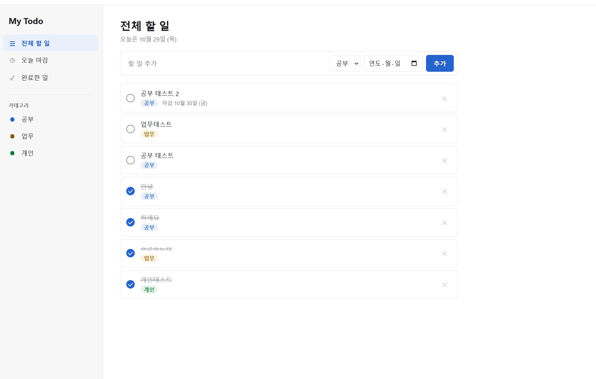
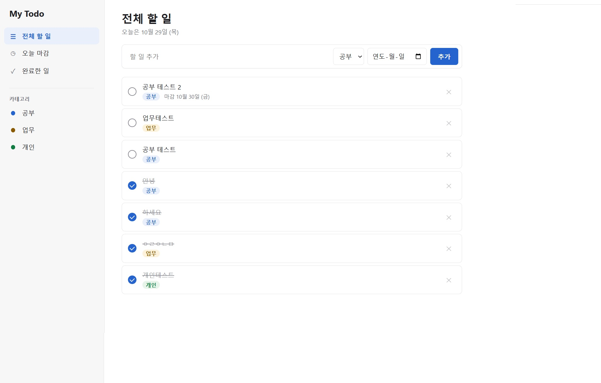

# My Todo

카테고리(공부 / 업무 / 개인)와 마감일로 할 일을 관리하는 웹 애플리케이션입니다.
요구사항은 [PRD.md](PRD.md)를 참고하세요.

## 실행 방법

Node.js 22.9 이상이 필요합니다.

```bash
npm install
npm start
```

브라우저에서 <http://localhost:3000> 을 엽니다.
처음 실행하면 프로젝트 폴더에 `todo.db`가 만들어지고, 할 일 데이터는 이 파일에 저장됩니다.

포트나 DB 파일 위치를 바꾸려면 `.env.example`을 `.env`로 복사해서 값을 수정합니다.

## 테스트

```bash
npm test
```

테스트는 임시 DB를 사용하므로 `todo.db`에는 영향을 주지 않습니다.

## 검증 기록

### 길 A - 로컬 SQLite (2026-10-29)

- 할 일 추가·조회·완료·삭제가 화면에서 정상 동작함을 확인했다.
- 서버를 종료했다가 다시 실행한 뒤 새로고침해도 할 일 7개가 완료 상태까지 그대로 남아 있었다.
- 자동 테스트(`npm test`) 13개 통과: CRUD, 입력 검증, 메뉴별 조회, 재시작 후 데이터 유지.

| 서버 끄기 전 | 서버를 껐다 켠 후 |
| --- | --- |
|  |  |

서버 재시작 후 API로 조회한 결과:

```text
My Todo 실행 중: http://localhost:3000
DB 파일: ...\261026\todo.db
재시작 후 저장된 할 일: 7개
 - [    ] 공부 테스트 2
 - [    ] 업무테스트
 - [    ] 공부 테스트
 - [완료] 안녕
 - [완료] 하세요
 - [완료] ㅇㄹㅇㄴㅁ
 - [완료] 개인테스트
```

### 길 B - Supabase

(진행 예정)

## 폴더 구조

```text
server/
  index.js                 서버 시작 (환경변수 읽기, DB 연결)
  app.js                   Express 앱과 API 라우트
  validation.js            요청 값 검증
  db/schema.sql            SQLite 테이블 생성 스키마 + 카테고리 seed
  db/sqlite.js             DB 연결 (FK 활성화, 스키마 적용)
  repositories/
    sqliteTodoRepository.js  SQL 쿼리 (길 B에서 Supabase 저장소로 교체)
public/
  index.html, style.css, app.js   화면
test/
  api.test.js              API 자동 테스트
```
